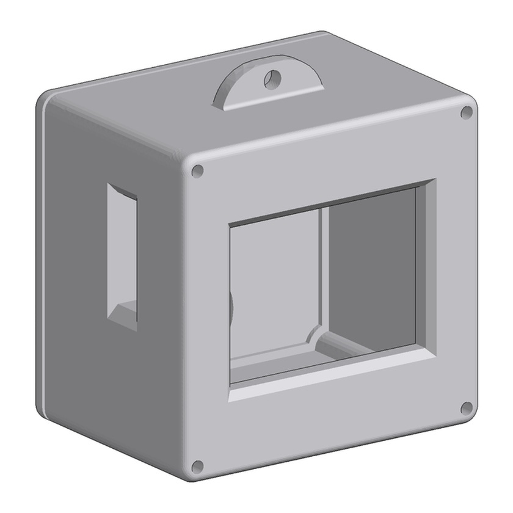
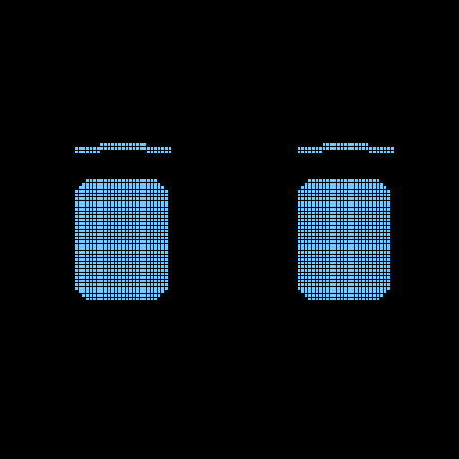
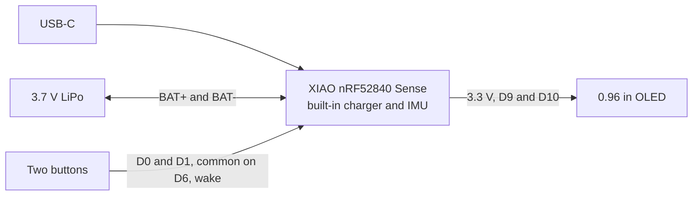
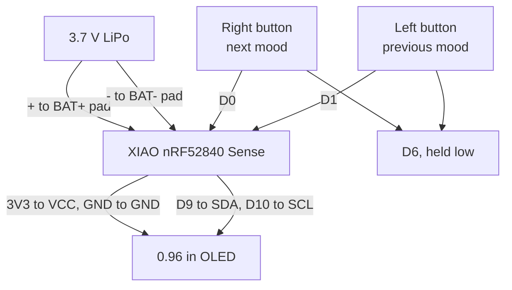
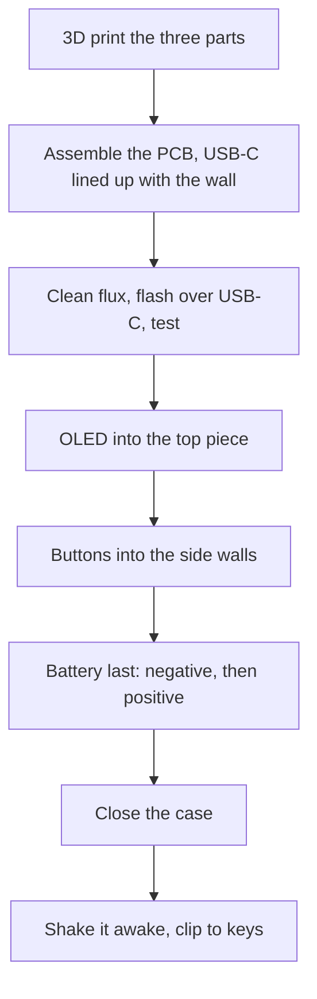
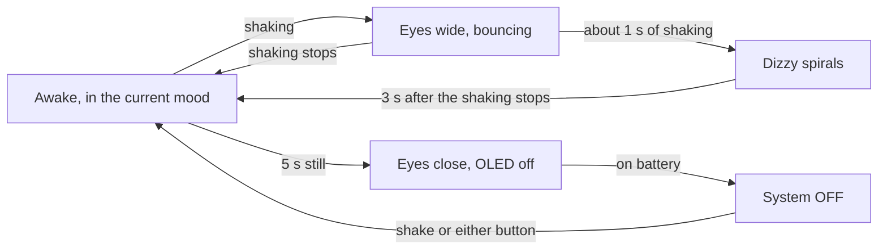

# solareyes

<table>
  <tr>
    <td></td>
    <td></td>
    <td></td>
  </tr>
</table>

Solar Eyes is a small rechargeable keychain that plays animated eyes on a 0.96" OLED. This is version 2. It charges over USB-C and has no power switch: it falls asleep when it sits still, and a shake wakes it up. Shake it for about a second and it gets dizzy. There is no Wi-Fi, app, or account, and Bluetooth stays off.

**Looking for version 1, the one with the solar panel?** It is on the [`v1` branch](https://github.com/hronkrobotics/solareyes/tree/v1). Version 2 dropped the panel and kept the name.

A Seeed Studio XIAO nRF52840 Sense runs the same eye animation as v1. It sits on a small custom PCB inside a three-piece 3D-printed case, along with two buttons that step through the moods. The XIAO's built-in charger replaces the solar charger and the 5 V converter from v1, and its built-in accelerometer handles shake to wake.

## Project Status

Version 2 is in progress. The case is designed, and the three printed parts are in [`3d/`](3d). The firmware runs on the XIAO nRF52840 Sense with the OLED wired up, and both the OLED and the XIAO's accelerometer answer on startup. Shake-to-wake from deep sleep, the dizzy mode, and the battery life are not tested yet, and the custom PCB is not final.

There are no build photos yet. The pictures above are a render of the case and two clips of the eye animation, made by running the firmware's drawing code on a PC.

## System Overview

The LiPo connects straight to the XIAO's BAT+ and BAT- pads, and when the keychain is not in use, the XIAO sits in deep sleep. The XIAO charges the battery from USB-C and runs from it the rest of the time. Its 3.3 V pin powers the OLED, which talks to it over I2C on D9 and D10. The buttons are on D0 and D1, and both of their other legs go to D6. The sketch holds D6 low, so that pad is ground for the buttons. The accelerometer is the LSM6DS3TR-C IMU built into the XIAO, and its interrupt line can wake the XIAO from deep sleep, the same as the buttons.

The firmware is one Arduino sketch, split into a few files. The eyes are the same two rounded rectangles as v1, moved around with `millis()` timing.



## Bill of Materials

The final parts are not all ordered yet, so most prices are blank. The OLED is the same listing as v1, at its Amazon.ca price in CAD on October 26, 2026.

| Item | Listing | Notes | Used | Price / pack |
|---|---|---|---:|---:|
| XIAO nRF52840 Sense | [Seeed Studio](https://www.seeedstudio.com/Seeed-XIAO-BLE-Sense-nRF52840-p-5253.html) | 21 x 17.8 mm, USB-C, built-in LiPo charger and LSM6DS3TR-C accelerometer | 1 | |
| 0.96" OLED | [ELEGOO 0.96" OLED, 3-pack](https://www.amazon.ca/dp/B0D2RMQQHR) | Same as v1. 128 x 64, I2C, SSD1306 at `0x3C` | 1 of 3 | C$18.99 |
| LiPo battery | 3.7 V LiPo with a protection circuit | Small enough to fit behind the PCB | 1 | |
| Buttons | Momentary push buttons | One in each 11.8 mm hole in the side walls | 2 | |
| Custom PCB | Not in the repo yet | Carries the XIAO and connects the OLED, the buttons, and the battery | 1 | |

Also needed, from parts on hand: hookup wire, a key ring, and 3D printer filament.

## Required Tools

| Tool | Purpose |
|---|---|
| 3D printer | The top piece, outer wall, and bottom piece |
| Soldering iron and solder | The XIAO, the OLED header, the buttons, and the battery leads |
| Rosin flux | Getting solder to wet the XIAO's edge pads and the header pins |
| Isopropyl alcohol (90%+) and a toothbrush | Cleaning flux off so pins do not leak current into each other |
| Multimeter | Battery polarity and checking for shorts |
| Flush cutters | Trimming header pins |
| Arduino IDE | Uploading the firmware in `solar_eyes/` |

## 3D-Printed Parts

[`3d/`](3d) has the three printed parts as STEP files, in millimeters. Most slicers, including Bambu Studio, OrcaSlicer, and PrusaSlicer, open STEP files directly.


| File | Part |
|---|---|
| [`solar-eyes-top.step`](3d/solar-eyes-top.step) | Top piece. Holds the OLED so the screen sits flush with the front face. Four pins on the back, 23.5 mm apart, go through the OLED module's mounting holes. |
| [`solar-eyes-wall.step`](3d/solar-eyes-wall.step) | Outer wall. Joins the top and bottom pieces. It has the USB-C opening on the left side, an 11.8 mm button hole in each side wall, and the key ring loop on top. |
| [`solar-eyes-bottom.step`](3d/solar-eyes-bottom.step) | Bottom piece. A plain back cover. |

Put together, the case is 42 x 40 x 24.5 mm, plus the key ring loop. The three parts line up on four corner holes.

## Board Layout

The PCB is not finished, so there is no fixed layout yet. The case does fix where a few things go. In this build, "left" and "right" are as seen from the front, looking at the screen, with the key ring loop on top.

**USB-C.** The XIAO's USB-C port has to face the opening in the left wall. That opening is a short tunnel, so the port sits 11 mm in from the outside of the case, about 24.7 mm up from the bottom edge and 14.1 mm behind the front face.

**Buttons.** Each side wall has an 11.8 mm hole for a button, centered 8.8 mm up from the bottom edge and 14.1 mm behind the front face. The right-hand button steps to the next mood and the left-hand one to the previous mood.

**OLED.** The OLED sits behind the window in the top piece, centered on the front face.

```text
                 key ring loop
        +------------( o )------------+
        |                             |
        |   +---------------------+   |
        |   |                     |   |
 USB-C ==   |     OLED window     |   |
        |   |                     |   |
        |   +---------------------+   |
 prev  ()                             ()  next
        +-----------------------------+
```

**Inside.** The inside of the case is about 38 x 36 mm, with a post in each corner, and about 19 mm deep between the top and bottom pieces.

**Side view of the stack**, from the face you look at to the back of the keychain:


## Wiring



| From | To | Notes |
|---|---|---|
| XIAO 3V3 / GND | OLED VCC / GND | Display power comes from the XIAO's 3.3 V pin. Go by the labels on the OLED; some modules put VCC first. |
| XIAO D9 | OLED SDA | I2C data |
| XIAO D10 | OLED SCL | I2C clock |
| XIAO D0 | Right-hand button | Next mood. The other leg goes to D6. Uses the internal pull-up, and also wakes the XIAO. |
| XIAO D1 | Left-hand button | Previous mood. The other leg goes to D6. Uses the internal pull-up, and also wakes the XIAO. |
| XIAO D6 | Both buttons, the shared leg | The sketch drives this pin low, so it takes the place of GND for the buttons. It is on the same edge as D0 and D1. |
| LiPo + | XIAO BAT+ | |
| LiPo - | XIAO BAT- | Check the labels on the back of the XIAO. |

The accelerometer needs no wiring. It is built into the XIAO, on its own internal I2C bus.

**Why these pins.** D9 and D10 are not the XIAO's default I2C pins (D4 and D5), so the sketch sets them explicitly. They sit right next to 3V3 and GND on the edge of the XIAO, which keeps the OLED's four connections short. Any nRF52840 pin can wake it from deep sleep, so D0 and D1 are just free pins on the other side. D6 is on that same edge, and the sketch holds it low so the button grounds can land there too.

## Assembly

### 1. 3D print the parts

Print the top piece, outer wall, and bottom piece from [`3d/`](3d).

### 2. Assemble the PCB

Solder the XIAO to the PCB, then the connections for the OLED, the two buttons, and the battery, following the [wiring table](#wiring). Place the XIAO so its USB-C port lines up with the opening in the wall (see [Board Layout](#board-layout)). Do not connect the battery yet.

If the solder balls up instead of sticking, add flux and hold the iron on the pin and the pad together for a couple of seconds before feeding solder in.

### 3. Clean and test

Scrub the flux off with isopropyl alcohol and a toothbrush, then let it dry completely. Check for solder bridges.

Connect the OLED, plug in USB-C, and upload the firmware (see [Firmware](#firmware)). Confirm the eyes show up, and press both buttons to step through the moods. Open the serial monitor to see which I2C devices the XIAO found, whether the OLED and the accelerometer answered, and what woke it. Fixing a problem is much easier now than after everything is in the case.

### 4. Fit the OLED

Put the OLED into the top piece with the screen facing out, so the glass sits flush with the front face. Its four mounting holes go over the four pins on the back of the top piece.

### 5. Fit the buttons

Put one button into each side hole of the outer wall, and connect them to the PCB. Seen from the front, the next-mood button goes on the right and the previous-mood button on the left.

### 6. Connect the battery last

Connect the battery last so you are never soldering on a live circuit. There is no power switch, so the XIAO starts as soon as the battery is connected.

1. Meter the battery. It should read between 3.7 and 4.2 V.
2. Find the XIAO's BAT+ and BAT- pads, labeled on its back.
3. Connect the battery's negative lead to BAT- first. Leave the positive lead floating and insulated.
4. Connect the positive lead to BAT+ last. The eyes should open within a second.

### 7. Close the case

Fit the PCB and the battery into the outer wall, with the USB-C port in its opening and the buttons in their holes. Keep the battery clear of sharp solder joints. Put the top and bottom pieces on, lining up the four corner holes.

### 8. Shake it awake

After five seconds with no movement, the eyes close and it goes to sleep. Give it a shake to wake it up, then clip it onto your keys.



## Firmware

The firmware is an Arduino sketch in [`solar_eyes/`](solar_eyes). The eye drawing is carried over from v1: U8g2 draws into a 128 x 64 framebuffer in RAM, and the sketch pushes that buffer to the SSD1306 itself over I2C at 100 kHz, the speed that worked on the v1 panel.

| File | Contents |
|---|---|
| `solar_eyes.ino` | Setup, the main loop, and the serial status report |
| `config.h` | Pins, the sleep timeout, and the shake and dizzy settings |
| `display.h` | OLED setup, sending frames, and switching the display off and on |
| `animations.h` | The eyes, the moods, the dizzy spirals, and falling asleep |
| `input.h` | Reading and debouncing the two buttons |
| `motion.h` | The built-in accelerometer: movement, shaking, and the wake-up interrupt |
| `power.h` | The inactivity timer, saving the mood, and deep sleep |

### Uploading

Open `solar_eyes/solar_eyes.ino` in the Arduino IDE with these settings:

| Setting | Value |
|---|---|
| Boards Manager URL | `https://files.seeedstudio.com/arduino/package_seeeduino_boards_index.json`, under File > Preferences |
| Board package | Seeed nRF52 Boards (built with 1.1.13). Not the mbed-enabled one. |
| Board | Seeed XIAO nRF52840 Sense |
| Library | U8g2 by oliver |

The IDE resets the XIAO into its bootloader for each upload, and the port number changes along the way. If an upload cannot find the board, double-tap the XIAO's reset button to start the bootloader by hand, then upload again.

When a serial monitor connects, the sketch prints a short report: the I2C devices on D9 and D10, whether the OLED and the accelerometer answered, what woke it, the mood, and whether it is on USB or battery power. Send `a` to stream the accelerometer.

### The eyes

Each eye is a filled rounded rectangle with no pupil. The eye looks around by changing shape. When the face turns to one side, the near eye gets a little bigger, the far eye a little smaller, and the two slide closer together. Arched eyebrows move with each eye, and the eyes bob slightly while idle. Every change eases in over a few frames instead of snapping.

The top 16 rows of this panel are yellow glass. The sketch keeps those rows dark, so only blue pixels light up.

The right-hand button steps to the next mood and the left-hand button to the previous one. Each mood changes the resting look and which expressions come up. The mood is saved to the XIAO's flash each time it goes to sleep, so it comes back the same way even after the battery is unplugged.

Tilting the keychain makes the eyes look the other way. Tip it back and they look down. Tip it left and they look right. A small tilt does nothing, and by about 40 degrees they look all the way over.

| Mood | Look |
|---|---|
| Normal | The v1 eyes: blinking, glancing around, looking up and down, winking, getting sleepy |
| Happy | Eyes curved up into arches, with arched brows |
| Sleepy | Half-closed eyes, slow blinks, looking down |
| Angry | Narrowed eyes, with the brows slanting down toward the middle |
| Sad | Smaller, lower eyes, with the brows slanting up toward the middle |

### Shake and dizzy

Shaking makes the eyes go wide and bounce. About a second of solid shaking turns them into spinning spirals. Short pauses do not start that count over. They stay dizzy for 3 seconds after the shaking stops, then blink back to the current mood. `SHAKE_MG`, `DIZZY_SHAKE_MS`, and `DIZZY_FOR_MS` in `config.h` set how hard and how long.

### Sleep and shake to wake

There is no power switch, so deep sleep is how the keychain turns off. After 5 seconds with no button press, no movement, and no change in tilt (`SLEEP_AFTER_MS`), the eyes get sleepy and close, and the OLED turns off. On battery, the nRF52840 then goes into System OFF, its deepest sleep. A shake wakes it, through the accelerometer's interrupt line, and so does either button. It wakes up with its eyes opening. If the accelerometer does not answer at startup, only the buttons wake it.

Plugged into USB, it only turns the screen off and stays running, so the serial port stays up and a shake brings the eyes straight back.

On a key ring, something in a pocket can hold a button down. A button held for more than 10 seconds (`STUCK_BUTTON_MS`) stops keeping the keychain awake, and it is left out of the wake-up pins, so it cannot wake the keychain straight back up.



A full frame takes about a tenth of a second to send at 100 kHz, so the sketch sends it one page (8 rows) at a time and reads the buttons in between. Bluetooth is never started.

### Accelerometer

The XIAO nRF52840 Sense has an LSM6DS3TR-C IMU built in, so v2 needs no separate accelerometer. The IMU sits on the XIAO's internal I2C bus and is powered from one of its pins, which stays on during System OFF so the IMU can wake the board.

`motion.h` uses two parts of the chip. The gyroscope stays off.

- Its wake-up interrupt watches high-pass filtered data, so gravity and slow tilting are ignored. Past `WAKE_MG` it drives its interrupt line high. That line wakes the XIAO from System OFF, and any movement while awake restarts the sleep timer.
- Each reading is split into gravity, which gives the tilt, and the leftover. The leftover fills a shake meter when it passes `SHAKE_MG`.

At 26 Hz in low-power mode, the accelerometer draws about 14 uA, by ST's figures. Switching to a different accelerometer only means rewriting `motion.h`.

## Power Notes

These are estimates from datasheets, not measurements.

- **Charging.** The XIAO charges the LiPo at about 50 mA by default, so a 250 mAh cell takes about 5 hours from empty. The battery is always connected, so plugging in USB-C always charges it, and the XIAO's charge LED lights while it does.
- **Awake.** The nRF52840 draws a few milliamps while it runs, and the OLED adds a few milliamps for the lit pixels.
- **Asleep.** Seeed rates the XIAO nRF52840 at under 5 uA in deep sleep. The accelerometer adds about 14 uA, the battery-sense divider about 3 uA, and the sleeping OLED a few more, so the whole keychain should sit at a few tens of microamps.

## Notes and Limitations

Version 2 is still being built, and it has known rough edges. Future versions will attempt to resolve these in some capacity.

- **Partly tested on hardware.** See [Project Status](#project-status).
- **The shake thresholds are starting points.** `WAKE_MG` and `SHAKE_MG` in `config.h` will need tuning on the real keychain.
- **No power switch.** Deep sleep is the off state. For storage longer than a few months, disconnect the battery.
- **The USB port disappears in System OFF.** That only happens on battery. Plugged into USB, the keychain stays running.
- **No battery gauge yet.** The XIAO can read its own battery voltage through a divider on P0.31, but the firmware does not use it yet.
- **I2C runs at 100 kHz.** That is what the v1 panel needed on perfboard wiring. 400 kHz may work on the PCB, but the eyes would move faster too, since they ease one step per frame.

## Future Improvements

- Finish the PCB and add its design files to the repo
- Tune the shake thresholds on the real keychain
- Build photos, and a video of the build and the reveal
- Battery level from the XIAO's built-in battery-sense divider
- More moods and expressions

## References

- [U8g2](https://github.com/olikraus/u8g2) and the [C++ setup guide](https://github.com/olikraus/u8g2/wiki/u8g2setupcpp)
- [Seeed Studio XIAO nRF52840 (Sense) wiki](https://wiki.seeedstudio.com/XIAO_BLE/)
- [ST LSM6DS3TR-C datasheet](https://www.st.com/resource/en/datasheet/lsm6ds3tr-c.pdf)
- Version 1, with the solar panel: the [`v1` branch](https://github.com/hronkrobotics/solareyes/tree/v1)
- The next project in the same line: [Solar Square](https://github.com/hronkrobotics/solar-square)
- Earlier project in the same style: [robotictentacle](https://github.com/hronkrobotics/robotictentacle)

## Disclaimer

This is a small LiPo project. Check the battery's polarity with a meter before connecting it, using the BAT+ and BAT- labels on the back of the XIAO. Do not charge a damaged or swollen pouch, do not solder on the circuit while the battery is connected, and keep the pouch from being pinched or punctured when the case is closed.
