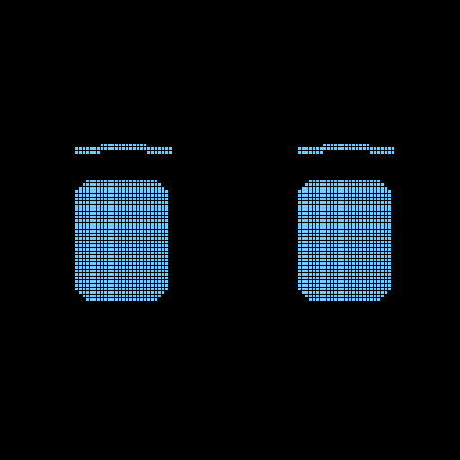
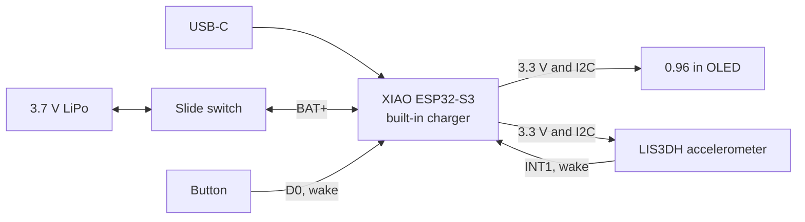
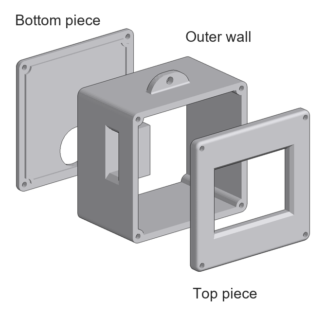
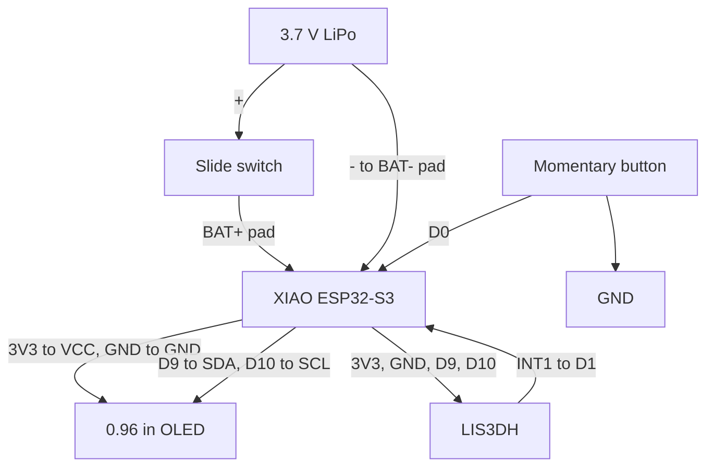
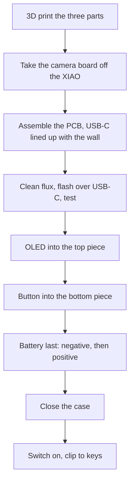
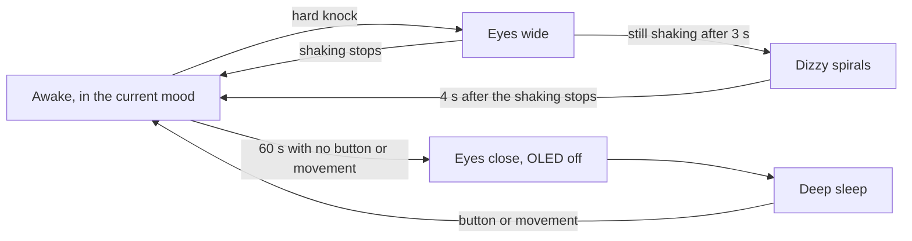

# solareyes

<table>
  <tr>
    <td></td>
    <td></td>
    <td></td>
  </tr>
</table>

Solar Eyes is a small rechargeable keychain that plays animated eyes on a 0.96" OLED. This is version 2. It charges over USB-C, falls asleep when it sits still, and wakes up when you pick up your keys. Shake it for a few seconds and it gets dizzy. There is no Wi-Fi, Bluetooth, app, or account.

**Looking for version 1, the one with the solar panel?** It is on the [`v1` branch](https://github.com/hronkrobotics/solareyes/tree/v1). Version 2 dropped the panel and kept the name.

A Seeed Studio XIAO ESP32-S3 Sense runs the same eye animation as v1. It sits on a small custom PCB inside a three-piece 3D-printed case, along with an accelerometer, a button that changes the mood, and a slide switch. The XIAO's built-in charger replaces the solar charger and the 5 V converter from v1.

## Project Status

Version 2 is in progress. The case is designed, and the three printed parts are in [`3d/`](3d). The firmware compiles for the XIAO ESP32-S3 and reuses the v1 eye code, but it has not run on the v2 hardware yet. The custom PCB and the accelerometer are not final, so shake-to-wake and the dizzy mode are written but untested.

There are no build photos yet. The pictures above are a render of the case and two clips of the eye animation, made by running the firmware's drawing code on a PC.

## System Overview

The LiPo connects to the XIAO's BAT+ and BAT- pads, with the slide switch in the positive lead. The XIAO charges the battery from USB-C and runs from it the rest of the time. Its 3.3 V pin powers the OLED and the accelerometer, which share one I2C bus on D9 and D10. The button is on D0 and the accelerometer's interrupt is on D1. Either one can wake the XIAO from deep sleep.

The firmware is one Arduino sketch, split into a few files. The eyes are the same two rounded rectangles as v1, moved around with `millis()` timing.



## Bill of Materials

The final parts are not all ordered yet, so most prices are blank. The OLED is the same listing as v1, at its Amazon.ca price in CAD on October 26, 2026. The XIAO price is Seeed's, in USD, on November 17, 2026.

| Item | Listing | Notes | Used | Price / pack |
|---|---|---|---:|---:|
| XIAO ESP32-S3 Sense | [Seeed Studio](https://www.seeedstudio.com/XIAO-ESP32S3-Sense-p-5639.html) | 21 x 17.8 mm, USB-C, built-in LiPo charger. The camera board it ships with is not used. | 1 | US$18.90 |
| 0.96" OLED | [ELEGOO 0.96" OLED, 3-pack](https://www.amazon.ca/dp/B0D2RMQQHR) | Same as v1. 128 x 64, I2C, SSD1306 at `0x3C` | 1 of 3 | C$18.99 |
| Accelerometer | [ST LIS3DH](https://www.st.com/en/mems-and-sensors/lis3dh.html) | 3 x 3 mm, I2C, interrupt output, about 4 uA. Goes on the PCB. Not final. | 1 | |
| LiPo battery | 3.7 V LiPo with a protection circuit | Small enough to fit behind the PCB | 1 | |
| Slide switch | Mini slide switch | Cuts the battery's positive lead | 1 | |
| Tactile button | Momentary tactile button | Its cap pokes out through the 12 mm hole in the bottom piece | 1 | |
| Custom PCB | Not in the repo yet | Carries the XIAO and the accelerometer, and connects the OLED, button, switch, and battery | 1 | |

Also needed, from parts on hand: hookup wire, a key ring, and 3D printer filament.

## Required Tools

| Tool | Purpose |
|---|---|
| 3D printer | The top piece, outer wall, and bottom piece |
| Soldering iron and solder | The XIAO, the OLED header, the button, the switch, and the battery leads |
| Rosin flux | Getting solder to wet the XIAO's edge pads and the header pins |
| Isopropyl alcohol (90%+) and a toothbrush | Cleaning flux off so pins do not leak current into each other |
| Multimeter | Battery polarity and checking for shorts |
| Flush cutters | Trimming header pins |
| Arduino IDE | Uploading the firmware in `solar_eyes/` |

## 3D-Printed Parts

[`3d/`](3d) has the three printed parts as STEP files, in millimeters. Most slicers, including Bambu Studio, OrcaSlicer, and PrusaSlicer, open STEP files directly.



| File | Part |
|---|---|
| [`solar-eyes-top.step`](3d/solar-eyes-top.step) | Top piece. Holds the OLED so the screen sits flush with the front face. The OLED module's four mounting holes line up with four points on the back, 23.5 mm apart. |
| [`solar-eyes-wall.step`](3d/solar-eyes-wall.step) | Outer wall. Joins the top and bottom pieces. It has the USB-C opening on the left side and the key ring loop on top. |
| [`solar-eyes-bottom.step`](3d/solar-eyes-bottom.step) | Bottom piece. Holds the tactile button, which pokes out through a 12 mm hole. |

Put together, the case is 42 x 40 x 30.5 mm, plus the key ring loop. The three parts line up on four corner holes.

## Board Layout

The PCB is not finished, so there is no fixed layout yet. The case does fix where a few things go. In this build, "left" and "right" are as seen from the front, looking at the screen, with the key ring loop on top.

**Front.** The OLED window is centered on the front face. The XIAO's USB-C port has to face the opening in the left wall. That opening is a short tunnel, so the port sits 11 mm in from the outside of the case, about 24.7 mm up from the bottom edge and 12.4 mm behind the front face.

```text
                key ring loop
       +------------( o )------------+
       |                             |
       |   +---------------------+   |
       |   |                     |   |
USB-C ==   |     OLED window     |   |
       |   |                     |   |
       |   +---------------------+   |
       |                             |
       +-----------------------------+
```

**Back.** The button pokes out through the 12 mm hole in the bottom piece, centered left to right, with its center 9 mm up from the bottom edge. Seen from the back, the USB-C opening is on the right.

```text
       +------------( o )------------+
       |                             |
       |                             |
       |                             == USB-C
       |                             |
       |            (   )            |   12 mm button hole
       |                             |
       +-----------------------------+
```

**Inside.** The inside of the case is about 38 x 36 mm, with a post in each corner, and about 22 mm deep between the top and bottom pieces.

**Side view of the stack**, from the face you look at to the back of the keychain:


## Wiring



| From | To | Notes |
|---|---|---|
| XIAO 3V3 / GND | OLED VCC / GND | Display power comes from the XIAO's 3.3 V pin. |
| XIAO D9 (GPIO8) | OLED SDA | I2C data, shared with the accelerometer |
| XIAO D10 (GPIO9) | OLED SCL | I2C clock, shared with the accelerometer |
| XIAO 3V3 / GND | LIS3DH VDD and VDD_IO / GND | Add the decoupling capacitors from the datasheet. |
| XIAO D9 / D10 | LIS3DH SDA / SCL | Same bus as the OLED. Tie CS to 3V3 to select I2C. SDO sets the address, `0x18` or `0x19`; the sketch tries both. |
| LIS3DH INT1 | XIAO D1 (GPIO2) | Goes high when the keychain moves, which wakes the XIAO. |
| XIAO D0 (GPIO1) | Momentary button, other leg to GND | Uses the ESP32's internal pull-up. The button also wakes the XIAO. |
| LiPo + | Slide switch, then XIAO BAT+ | The switch cuts the battery off completely. |
| LiPo - | XIAO BAT- | BAT- is the pad closer to the USB-C port. |

**Why these pins.** D9 and D10 are not the XIAO's default I2C pins, so the sketch sets them explicitly. They sit right next to 3V3 and GND on the edge of the XIAO, which keeps the OLED's four connections short. D0 and D1 are RTC pins, so they can wake the ESP32-S3 from deep sleep. D2 (GPIO3) is a strapping pin, so it is left alone.

**The switch has to be on to charge.** It sits between the battery and the XIAO's charger. With the switch off, USB-C still runs the XIAO, but the battery does not charge.

## Assembly

### 1. 3D print the parts

Print the top piece, outer wall, and bottom piece from [`3d/`](3d).

### 2. Take the camera board off the XIAO

The XIAO ESP32-S3 Sense ships with a camera board plugged into the connector on its back. This build does not use the camera, microphone, or microSD slot, and with that board attached, Seeed rates the deep sleep current at 3 mA instead of 14 uA. Slide it off the connector and keep it for another project. The back of the XIAO then sits flat on the PCB.

### 3. Assemble the PCB

Solder the XIAO and the accelerometer to the PCB, then the connections for the OLED, the button, the slide switch, and the battery, following the [wiring table](#wiring). Place the XIAO so its USB-C port lines up with the opening in the wall (see [Board Layout](#board-layout)). Do not connect the battery yet.

The LIS3DH is a 3 x 3 mm chip with its pads underneath, which is hard to solder by hand. Having the PCB maker place it is easier.

If the solder balls up instead of sticking, add flux and hold the iron on the pin and the pad together for a couple of seconds before feeding solder in.

### 4. Clean and test

Scrub the flux off with isopropyl alcohol and a toothbrush, then let it dry completely. Check for solder bridges.

Connect the OLED, plug in USB-C, and upload the firmware (see [Firmware](#firmware)). Confirm the eyes show up, and press the button to step through the moods. The serial monitor says whether the accelerometer was found. Fixing a problem is much easier now than after everything is in the case.

### 5. Fit the OLED

Put the OLED into the top piece with the screen facing out, so the glass sits flush with the front face. Its four mounting holes go over the four points on the back of the top piece.

### 6. Fit the button

Put the tactile button into the bottom piece so its cap pokes out through the 12 mm hole, and connect it to the PCB.

### 7. Connect the battery last

Connect the battery last so you are never soldering on a live circuit.

1. Set the slide switch to off.
2. Find the XIAO's BAT- pad. It is the one closer to the USB-C port.
3. Connect the battery's negative lead to BAT- first. Leave the positive lead floating and insulated.
4. Connect the positive lead to the slide switch last.
5. With the switch still off, meter the battery side of the switch to ground. It should read between 3.7 and 4.2 V.

### 8. Close the case

Fit the PCB and the battery into the outer wall, with the USB-C port in its opening. Keep the battery clear of sharp solder joints. Put the top and bottom pieces on, lining up the four corner holes.

### 9. Switch it on

Flip the switch on. The eyes should open within a second. Clip it onto your keys.



## Firmware

The firmware is an Arduino sketch in [`solar_eyes/`](solar_eyes). The eye drawing is carried over from v1: U8g2 draws into a 128 x 64 framebuffer in RAM, and the sketch pushes that buffer to the SSD1306 itself over I2C at 100 kHz, the speed that worked on the v1 panel.

| File | Contents |
|---|---|
| `solar_eyes.ino` | Setup and the main loop, which ties the other files together |
| `config.h` | Pins, the sleep timeout, and the shake and dizzy settings |
| `display.h` | OLED setup, sending frames, and switching the display off and on |
| `animations.h` | The eyes, the moods, the dizzy spirals, and falling asleep |
| `input.h` | Reading and debouncing the button |
| `motion.h` | The accelerometer: movement, shaking, and the wake-up interrupt |
| `power.h` | The inactivity timer and deep sleep |

### Uploading

Open `solar_eyes/solar_eyes.ino` in the Arduino IDE with these settings:

| Setting | Value |
|---|---|
| Board package | esp32 by Espressif Systems, version 3.x (built with 3.3.5) |
| Board | XIAO_ESP32S3 |
| USB CDC On Boot | Enabled |
| CPU Frequency | 80MHz (WiFi). It draws less current, and 240MHz works too. |
| Library | U8g2 by oliver |

The USB port disappears while the XIAO is in deep sleep. Press the button to wake it before uploading. If the port still does not show up, hold the XIAO's BOOT button while plugging in the USB-C cable, then upload. While working on the firmware, set `DEEP_SLEEP` to `false` in `config.h`, so only the screen turns off.

### The eyes

Each eye is a filled rounded rectangle with no pupil. The eye looks around by changing shape. When the face turns to one side, the near eye gets a little bigger, the far eye a little smaller, and the two slide closer together. Arched eyebrows move with each eye, and the eyes bob slightly while idle. Every change eases in over a few frames instead of snapping.

The top 16 rows of this panel are yellow glass. The sketch keeps those rows dark, so only blue pixels light up.

A short press on the button switches to the next mood. Each mood changes the resting look and which expressions come up. The mood is kept through deep sleep, and goes back to Normal when the switch is turned off.

| Mood | Look |
|---|---|
| Normal | The v1 eyes: blinking, glancing around, looking up and down, winking, getting sleepy |
| Happy | Eyes curved up into arches, with arched brows |
| Sleepy | Half-closed eyes, slow blinks, looking down |
| Angry | Narrowed eyes, with the brows slanting down toward the middle |
| Sad | Smaller, lower eyes, with the brows slanting up toward the middle |

### Shake and dizzy

A hard knock makes the eyes go wide and jitter. Keep shaking it for about 3 seconds and they turn into spinning spirals. They stay dizzy for 4 seconds after the shaking stops, then blink back to the current mood. `SHAKE_MG`, `DIZZY_AFTER_MS`, and `DIZZY_FOR_MS` in `config.h` set how hard and how long.

### Sleep

After 60 seconds with no button press and no movement (`SLEEP_AFTER_MS`), the eyes get sleepy and close, and the OLED turns off. Then the XIAO goes into deep sleep. Pressing the button wakes it, and so does moving it, through the accelerometer's interrupt pin. It wakes up with its eyes opening. If no accelerometer answers at startup, only the button wakes it.



A full frame takes about a tenth of a second to send at 100 kHz, so the sketch sends it one page (8 rows) at a time and reads the button in between. Wi-Fi and BLE are never started.

### Accelerometer

Neither the XIAO ESP32-S3 nor its Sense camera board has an accelerometer. The camera board only adds a camera, a microphone, and a microSD slot. So v2 adds an accelerometer to the custom PCB, with its interrupt pin on D1.

`motion.h` is written for the ST LIS3DH, on the same I2C bus as the OLED. The chip watches for movement on its own, with gravity filtered out:

- Its first interrupt has a low threshold (`WAKE_MG`) and drives the INT1 pin. That pin wakes the XIAO from deep sleep, and any movement while awake restarts the sleep timer.
- Its second interrupt has a high threshold (`SHAKE_MG`) and is only read over I2C, to tell a hard shake from normal movement.

It runs at 25 Hz in low-power mode, which draws about 4 uA. The LIS2DH12 is a smaller 2 x 2 mm chip with the same registers, and works without changes. Switching to a different accelerometer only means rewriting `motion.h`.

## Power Notes

These are estimates from datasheets, not measurements.

- **Charging.** The XIAO charges the LiPo at 50 mA, so a 250 mAh cell takes about 5 hours from empty. The red charge LED on the XIAO blinks while it charges and goes out when the battery is full.
- **Awake.** Seeed rates the XIAO at about 22 mA from the battery, and the OLED adds a few milliamps for the lit pixels. Setting the CPU to 80 MHz in the board settings saves some of that.
- **Asleep.** Seeed rates the XIAO ESP32-S3 at 14 uA in deep sleep. The LIS3DH adds about 4 uA and the sleeping OLED a few more, so the whole keychain should sit at a few tens of microamps.
- **The camera board costs 3 mA.** With it attached, Seeed rates the deep sleep current at about 3 mA, which would empty a 250 mAh cell in under 4 days. That is why it comes off in [step 2](#2-take-the-camera-board-off-the-xiao).

## Notes and Limitations

Version 2 is still being built, and it has known rough edges. Future versions will attempt to resolve these in some capacity.

- **Untested on hardware.** The firmware compiles, but it has not run on the v2 PCB yet. See [Project Status](#project-status).
- **The accelerometer is not final.** Shake-to-wake and the dizzy mode need it. Without one, only the button wakes the keychain. The thresholds in `config.h` are starting points and will need tuning on the real keychain.
- **The USB port disappears in deep sleep.** Wake it with the button before uploading.
- **The camera board is not used.** If it stays on, it costs about 3 mA in deep sleep, and its microSD slot shares D8, D9, and D10 with the OLED, so the slot cannot be used.
- **No battery gauge.** The XIAO has no pin connected to the battery voltage, so reading it needs a voltage divider to a free analog pin.
- **I2C runs at 100 kHz.** That is what the v1 panel needed on perfboard wiring. 400 kHz may work on the PCB, but the eyes would move faster too, since they ease one step per frame.

## Future Improvements

- Finish the PCB and add its design files to the repo
- Confirm the accelerometer and tune the shake thresholds on the real keychain
- Build photos, and a video of the build and the reveal
- Battery-level reading through a voltage divider on a free analog pin
- More moods and expressions

## References

- [U8g2](https://github.com/olikraus/u8g2) and the [C++ setup guide](https://github.com/olikraus/u8g2/wiki/u8g2setupcpp)
- [Seeed Studio XIAO ESP32-S3 wiki](https://wiki.seeedstudio.com/xiao_esp32s3_getting_started/) and its [pin multiplexing page](https://wiki.seeedstudio.com/xiao_esp32s3_pin_multiplexing/)
- [ST LIS3DH datasheet](https://www.st.com/resource/en/datasheet/lis3dh.pdf)
- Version 1, with the solar panel: the [`v1` branch](https://github.com/hronkrobotics/solareyes/tree/v1)
- The next project in the same line: [Solar Square](https://github.com/hronkrobotics/solar-square)
- Earlier project in the same style: [robotictentacle](https://github.com/hronkrobotics/robotictentacle)

## Disclaimer

This is a small LiPo project. Check the battery's polarity with a meter before connecting it, and remember that BAT- is the XIAO pad closer to the USB-C port. Do not charge a damaged or swollen pouch, do not solder on the circuit while the battery is connected, and keep the pouch from being pinched or punctured when the case is closed.
